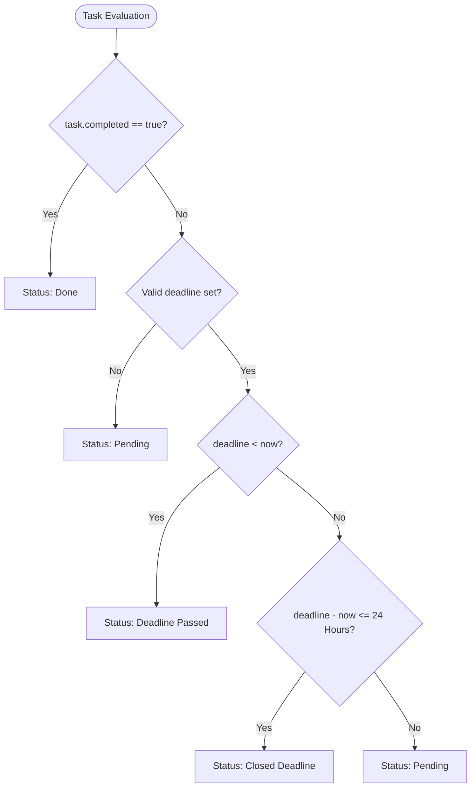

# TaskFlow &mdash; Modern To-Do & Task Management Web Application

A clean, modern, and responsive To-Do and Task Management single-page web application built with **semantic HTML5**, **modern CSS3**, and **Vanilla JavaScript (ES6+)**. 

TaskFlow enables users to organize tasks, academic schedules, study modules, and daily projects with real-time status tracking, dynamic deadline calculations, instant filtering, and local data persistence.

---

## 📌 Table of Contents

- [Key Features](#-key-features)
- [Status Classification & Logic](#-status-classification--logic)
- [Application Architecture](#-application-architecture)
- [Directory Structure](#-directory-structure)
- [Getting Started](#-getting-started)
- [How to Use the App](#-how-to-use-the-app)
- [Code Implementation Highlights](#-code-implementation-highlights)
- [Security & Accessibility](#-security--accessibility)
- [Browser Compatibility](#-browser-compatibility)
- [Project Context & Author](#-project-context--author)

---

## ✨ Key Features

- **Full CRUD Capabilities**:
  - **Create**: Add new tasks with title, deadline date/time, detailed description, and additional reference tags.
  - **Read**: View tasks formatted in modern, responsive grid cards.
  - **Update**: Edit existing task details at any time with form pre-population while preserving original creation timestamps.
  - **Delete**: Safely remove unwanted tasks with user confirmation safeguards.
- **Dynamic Task Status Engine**:
  - Automatically assesses deadline timestamps against current time and marks tasks as **Pending**, **Closed Deadline** (&le; 24 hours remaining), **Deadline Passed**, or **Done**.
- **Real-Time Interactive Dashboard**:
  - 5 live metric counters dynamically summarize total tasks and their corresponding statuses.
- **Instant Search & Status Filtering**:
  - Live, real-time search across task titles, descriptions, and reference tags.
  - Quick filter dropdown to isolate tasks by status category.
- **Local Persistence with Resilient Storage**:
  - Automatically saves all tasks to the browser's `localStorage`.
  - Includes schema validation, corruption recovery, and graceful fallbacks with pre-loaded mock tasks.
- **Modern UI & Responsive Design**:
  - Styled with custom CSS variables, Google Sans typography, responsive Grid & Flexbox, smooth hover transitions, and mobile-friendly viewports.
  - Non-intrusive toast notifications for feedback on user actions.

---

## ⏱ Status Classification & Logic

Every task's status is computed dynamically in `script.js` through `getTaskStatus(task)`:



| Status | Badge Color | Description | Condition |
| :--- | :--- | :--- | :--- |
| **Pending** | Amber / Orange (`#d97706`) | Task is scheduled and deadline is more than 24 hours away. | `deadline > 24h` or no deadline |
| **Closed Deadline** | Deep Orange (`#ea580c`) | High urgency; deadline is within the next 24 hours. | `0 < (deadline - now) <= 24h` |
| **Deadline Passed** | Red (`#dc2626`) | Task deadline has already passed without completion. | `deadline < now` & `!completed` |
| **Done** | Green (`#16a34a`) | Task is marked as finished. | `task.completed === true` |

---

## 🏛 Application Architecture

```
User Action (Click / Form Input / Search)
   │
   ▼
DOM Event Handlers (Listeners & Event Delegation)
   │
   ▼
State Operations (tasks array mutations, ID generation, validation)
   │
   ├──▶ Local Storage Layer (saveTasks / loadTasks / schema validation)
   │
   ▼
Render Pipeline
   ├──▶ Filter & Search Evaluation
   ├──▶ DOM Reconciliation (task cards grid generation & XSS sanitization)
   ├──▶ Dashboard Metric Counters Calculation (renderStatistics)
   └──▶ Empty State & Record Count Synchronization
```

---

## 📂 Directory Structure

```text
WebDev-L2-ToDoWebApp/
├── index.html        # Semantic HTML5 layout, dashboard, task grid, and modal dialog
├── style.css         # Modern styling, theme tokens, responsive grid, and badge designs
├── script.js         # Core application logic, DOM manipulation, storage, and utilities
└── README.md         # Comprehensive project documentation
```

---

## 🚀 Getting Started

No build tools, package managers, or backend servers are required. The project runs directly in any modern web browser.

### Option 1: Direct File Launch
1. Download or clone this repository.
2. Locate the file `index.html` in the `WebDev-L2-ToDoWebApp` directory.
3. Double-click `index.html` or drag it into any modern browser (Chrome, Edge, Firefox, Safari).

### Option 2: Live Server (VS Code Extension)
1. Open the project folder in **Visual Studio Code**.
2. Right-click `index.html` and select **"Open with Live Server"**.
3. The application will launch at `http://127.0.0.1:5500/index.html`.

---

## 📖 How to Use the App

1. **Adding a New Task**:
   - Click the **"+ Tambah Task Baru"** button in the header or empty-state section.
   - Enter the task title, choose the deadline date and time, provide a clear description, and optionally add reference links or tags.
   - Click **"Simpan Task"** to save.
2. **Marking a Task as Done / Undo**:
   - Click the **"Tandai Selesai"** button on any card.
   - The card status changes to **Done** and updates dashboard metrics.
   - Click **"Batal Selesai"** to return the task to active status.
3. **Editing a Task**:
   - Click the **"Edit"** button on the target task card.
   - Update any field in the pre-populated modal and click **"Simpan Perubahan"**.
4. **Deleting a Task**:
   - Click the **"Hapus"** button.
   - Confirm the prompt to remove the task permanently.
5. **Searching & Filtering**:
   - Type keywords into the search box to filter tasks by title, description, or tags in real-time.
   - Use the status dropdown to filter exclusively by *Pending*, *Closed Deadline*, *Deadline Passed*, or *Done*.

---

## 💻 Code Implementation Highlights

### 1. Data Sanitization & XSS Prevention
All user inputs rendered dynamically inside HTML card templates pass through `escapeHTML()`:
```javascript
function escapeHTML(str) {
    if (str === null || str === undefined) return "";
    return String(str).replace(/[&<>"']/g, match => {
        const entities = {
            "&": "&amp;",
            "<": "&lt;",
            ">": "&gt;",
            '"': "&quot;",
            "'": "&#39;"
        };
        return entities[match];
    });
}
```

### 2. Event Delegation for Dynamically Rendered Cards
Instead of binding listeners to individual buttons repeatedly on each render cycle, the application uses **event delegation** on the parent container (`taskCardsGrid`):
```javascript
taskCardsGrid.addEventListener("click", event => {
    const button = event.target.closest("button[data-action]");
    if (!button) return;

    const id = button.dataset.id;
    const action = button.dataset.action;

    if (action === "toggle") toggleTaskComplete(id);
    else if (action === "edit") openEditModal(id);
    else if (action === "delete") deleteTask(id);
});
```

### 3. Graceful LocalStorage Schema Recovery
The `loadTasks()` function protects against invalid formats or corrupted schemas:
```javascript
if (!Array.isArray(parsedData) || (parsedData.length > 0 && typeof parsedData[0] === "object" && !parsedData[0].title)) {
    return getInitialSampleTasks();
}
```

---

## 🛡 Security & Accessibility

- **Input Validation**: Required attributes, max lengths, and explicit date parsing checks prevent corrupt state.
- **Keyboard Navigation**:
  - Close modal dialog instantly with the <kbd>Escape</kbd> key.
  - Full tab-index flow on all interactive buttons, inputs, and links.
  - Visible focus outlines (`:focus-visible`) for keyboard accessibility.
- **ARIA Standards**:
  - Modal dialog with `role="dialog"`, `aria-modal="true"`, and `aria-labelledby`.
  - Screen-reader friendly live alerts on toast containers (`role="status"`, `aria-live="polite"`).

---

## 🌐 Browser Compatibility

Tested and compatible across all modern evergreen browsers:
- Google Chrome (Desktop & Mobile)
- Microsoft Edge
- Mozilla Firefox
- Safari (macOS & iOS)
- Opera / Brave

---

## 👨‍💻 Project Context & Author

- **Project**: Level 2 Web Development Task &mdash; To-Do Web Application
- **Internship Program**: Oasis Infobyte (OIBSIP) Web Development and Designing Internship
- **License**: MIT License &mdash; Free for educational and personal use.

